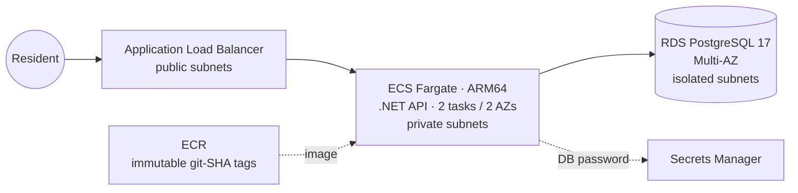
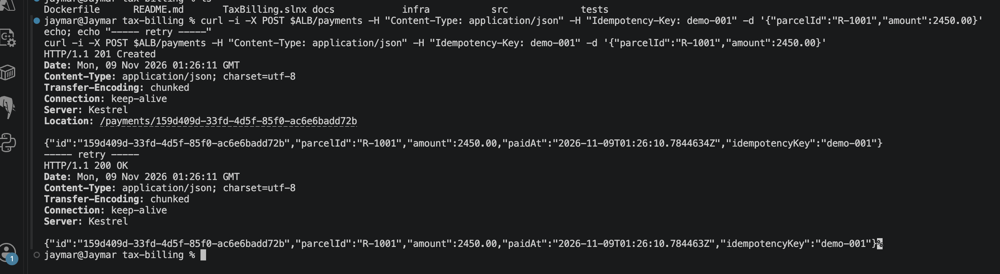
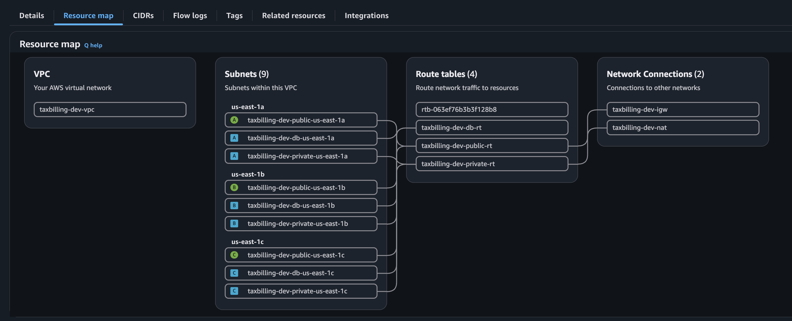
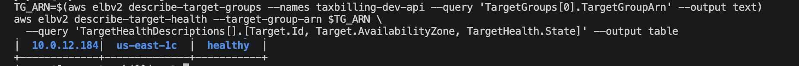
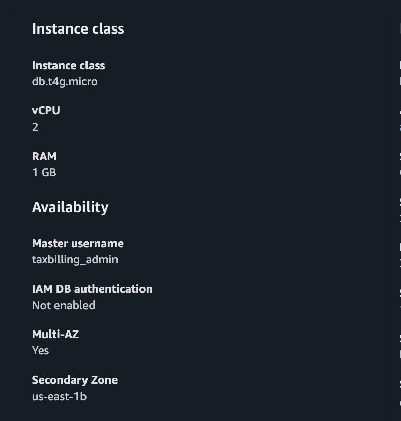

# Property Tax Billing Service on AWS

A production-style .NET 10 API for property tax bills and payments, deployed on AWS with Terraform. The goal is to run it the way a CloudOps team runs government SaaS: automated, secure and observable.

> 🚧 **Build in progress.** Steps 1–2 are complete. See the roadmap below.

## Architecture



## Roadmap

| Step | What                                                                                              | Status  |
| ---- | ------------------------------------------------------------------------------------------------- | ------- |
| 1    | .NET API: payments with idempotency keys, PostgreSQL/EF Core, xUnit tests, multi-stage Dockerfile | ✅ Done |
| 2    | Terraform: S3 remote state, 3-AZ VPC module, ECR, RDS Multi-AZ, ECS Fargate + ALB                 | ✅ Done |
| 3    | CI/CD: GitHub Actions, OIDC to AWS, Trivy scan, SHA-tagged images, prod approval                  | ⬜      |
| 4    | Event-driven: S3 → EventBridge → SQS → Python Lambda, with DLQ + alarm                            | ⬜      |
| 5    | Observability: Datadog APM, golden-signals dashboard, SLOs, k6 load test                          | ⬜      |
| 6    | Docs: architecture diagram, runbook, blameless postmortem                                         | ⬜      |

## Highlights

- **Idempotent payments across containers:** reproduced a double-charge bug, then fixed it with an `Idempotency-Key` header and a unique database index. Verified on AWS: a retry hitting either of 2 Fargate tasks returns the original payment.
- **Small, hardened image:** multi-stage build (975 MB SDK → 270 MB runtime), non-root user, no secrets baked in.
- **Remote state done right:** versioned, encrypted, TLS-only S3 bucket with native S3 locking (no DynamoDB).
- **Network isolation verified:** 3 tiers × 3 AZs. The database route table has no internet route.
- **No secrets in code or state:** the RDS password is generated by RDS and stored in Secrets Manager, then injected into ECS at startup. The repo history was scanned with gitleaks.
- **Production-style migrations:** the EF Core migration bundle runs as a one-off ECS task inside the VPC. The database is never exposed.
- **Zero-downtime deploys:** rolling ECS deployments with ALB health checks and a circuit breaker that rolls back automatically.

## Screenshots

|                                                                  |                                                  |
| ---------------------------------------------------------------- | ------------------------------------------------ |
| **Double-click blocked (201 → 200, same id)**                    | **VPC resource map (3 tiers × 3 AZs)**           |
|  |  |
| **2 healthy tasks in 2 AZs**                                     | **RDS Multi-AZ**                                 |
|     |      |

More in [`docs/screenshots/`](docs/screenshots/).

## Tech stack

.NET 10 · C# · EF Core · PostgreSQL 17 · xUnit · Docker · Terraform · AWS (VPC, ECR, RDS, ECS Fargate, ALB, Secrets Manager, S3, CloudWatch)

## Repo layout

```
src/TaxBilling.Api/          .NET API
tests/TaxBilling.Api.Tests/  xUnit tests
Dockerfile                   multi-stage build (+ EF migration bundle)
infra/
  bootstrap/                 S3 state bucket (run once)
  envs/dev/                  dev environment (remote state): network, ECR, RDS, ECS, ALB
  modules/network/           reusable 3-AZ VPC module
docs/screenshots/            deployment evidence
```

## Run locally

```bash
docker run -d --name taxbilling-db -e POSTGRES_USER=taxbilling -e POSTGRES_PASSWORD=devpassword \
  -e POSTGRES_DB=taxbilling -p 5433:5432 postgres:17
cd src/TaxBilling.Api
dotnet ef database update
dotnet run          # http://localhost:5088
dotnet test         # from the repo root
```
