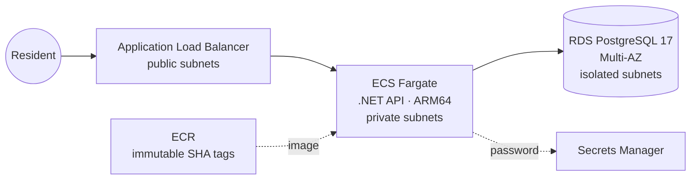

# Property Tax Billing Service on AWS

A production-style .NET 10 API for property tax bills and payments, deployed on AWS with Terraform. The goal is to run it the way a CloudOps team runs government SaaS: automated, secure and observable.

> 🚧 **Build in progress.** Steps 1–2 are under way. See the roadmap below.

## Architecture (target)



## Roadmap

| Step | What                                                                                              | Status         |
| ---- | ------------------------------------------------------------------------------------------------- | -------------- |
| 1    | .NET API: payments with idempotency keys, PostgreSQL/EF Core, xUnit tests, multi-stage Dockerfile | ✅ Done        |
| 2    | Terraform: S3 remote state, 3-AZ VPC module, ECR, RDS Multi-AZ, ECS Fargate + ALB                 | 🟡 In progress |
| 3    | CI/CD: GitHub Actions, OIDC to AWS, Trivy scan, SHA-tagged images, prod approval                  | ⬜             |
| 4    | Event-driven: S3 → EventBridge → SQS → Python Lambda, with DLQ + alarm                            | ⬜             |
| 5    | Observability: Datadog APM, golden-signals dashboard, SLOs, k6 load test                          | ⬜             |
| 6    | Docs: architecture diagram, runbook, blameless postmortem                                         | ⬜             |

## Highlights so far

- **Idempotent payments:** reproduced a double-charge bug, then fixed it with an `Idempotency-Key` header and a unique database index that holds across containers and concurrent retries.
- **Small, hardened image:** multi-stage build, from a 975 MB SDK image down to a 270 MB runtime image, running as non-root, with no secrets baked in.
- **Remote state done right:** versioned, encrypted, TLS-only S3 bucket with native S3 locking (no DynamoDB).
- **Network isolation verified:** 3 tiers × 3 AZs. The database route table has no internet route, confirmed with the AWS CLI.
- **No secrets in code or state:** the RDS password is generated by RDS and stored in Secrets Manager. The repo history was scanned with gitleaks.

## Tech stack

.NET 10 · C# · EF Core · PostgreSQL 17 · xUnit · Docker · Terraform · AWS (VPC, ECR, RDS, ECS Fargate, ALB, Secrets Manager, S3)

## Repo layout

```
src/TaxBilling.Api/       .NET API
tests/TaxBilling.Api.Tests/  xUnit tests
Dockerfile                multi-stage build
infra/
  bootstrap/              S3 state bucket (run once)
  envs/dev/               dev environment (remote state)
  modules/network/        reusable 3-AZ VPC module
```

## Run locally

```bash
docker run -d --name taxbilling-db -e POSTGRES_USER=taxbilling -e POSTGRES_PASSWORD=devpassword \
  -e POSTGRES_DB=taxbilling -p 5433:5432 postgres:17
cd src/TaxBilling.Api
dotnet ef database update
dotnet run          # http://localhost:5088
dotnet test         # from the repo root
```
